# Rise · RehabNinja

**Post-op rehab you play on your phone, with a crew in your corner and a care team watching your back.**

Patients stand in front of the camera, do today's assigned move, and good reps slice fruit. When a knee drifts in or their hands push off the chair, the fruit turns into a bomb. Behind the game, the same pose tracking measures the CDC-standard chair stand, so the care team sees real numbers while the patient only ever sees hits and misses.

Rise has three parts:

- **The game (RehabNinja).** Two minutes of play replace a form nobody fills in.
- **The crew.** A small, opt-in group of people on the same recovery path, cheering each other on, so recovering at home feels less isolated.
- **The clinic platform.** The care team launches a protocol for each patient, watches results arrive live, and decides every escalation with one human click.

Built for the Real-Time Video Agents Hack – NYC (VAST Builders Challenge). All patient data is synthetic.

**Live demo:** https://rise.nextrex.health (a Cloudflare Worker in front of one Cloudflare Container running the Next.js server). Tap **Try a demo** for Ellen's session, no camera needed, or open the clinic console from the staff link.

<p>
  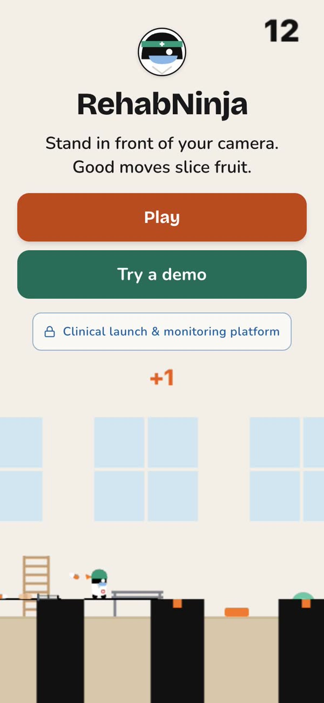
  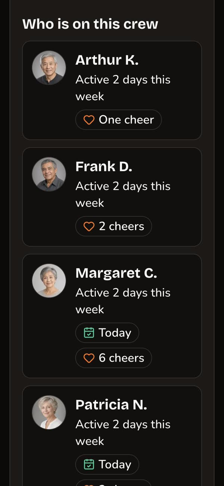
  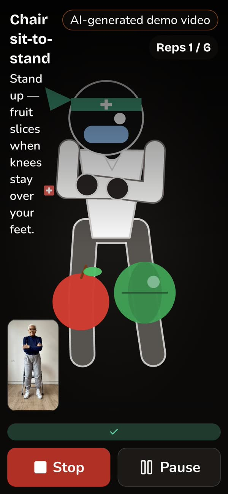
  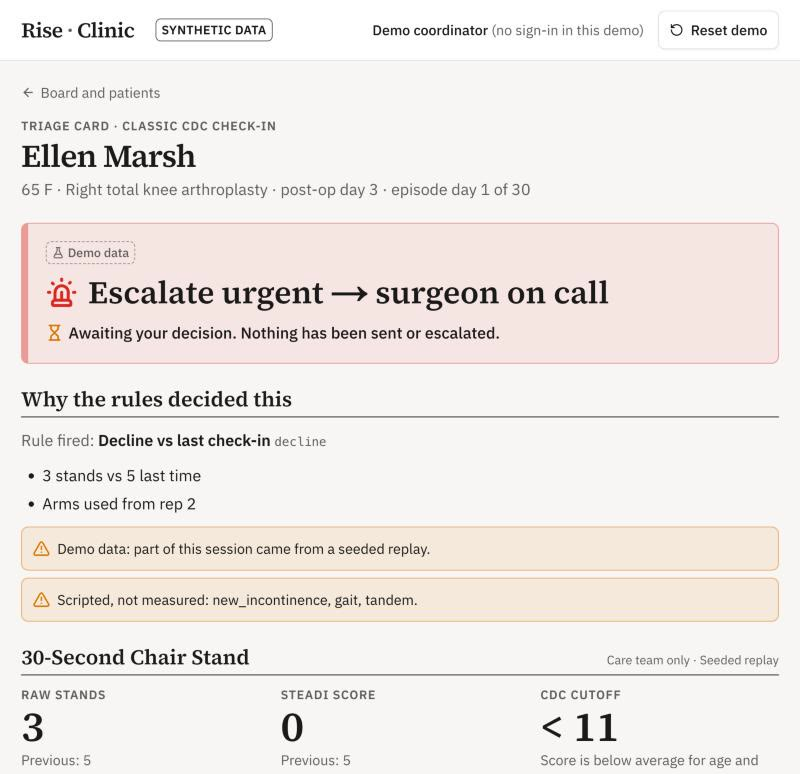
</p>

## Why

After a joint replacement, the day-7 phone call hears "I'm fine," and functional decline goes unseen until the next visit or the ED. Patients are often 60 to 80, recovering alone, with one phone. They won't fill in forms, and weeks at home with limited mobility can leave them isolated. Rise answers each problem in a different way:

| Problem | What Rise does |
| --- | --- |
| Forms go unanswered | A two-minute game measures the CDC STEADI 30-Second Chair Stand in the background |
| Recovering alone is isolating | An opt-in crew of peers on the same path: days active, a shared weekly goal, and cheers |
| Decline is noticed late | Every session lands on a live clinic board, triaged by written rules |
| Escalation is ad hoc | Each recommendation names a route (surgeon, primary care, or PT), and a person approves or downgrades it with a reason |

## For the patient

<p>
  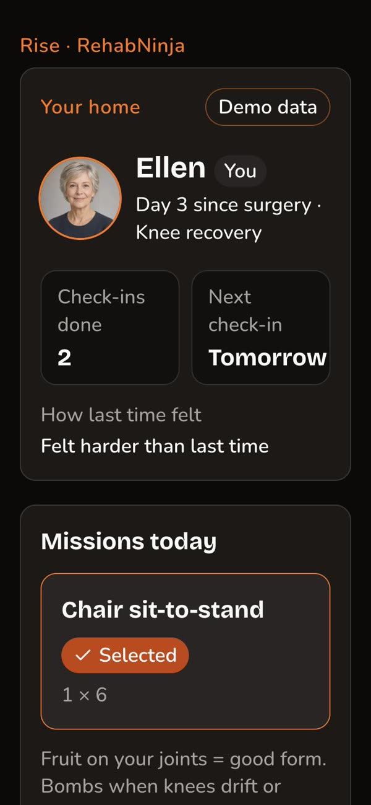
  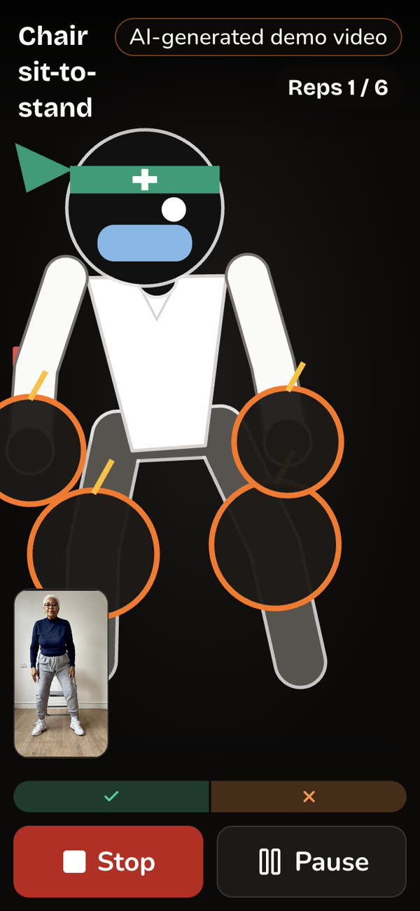
  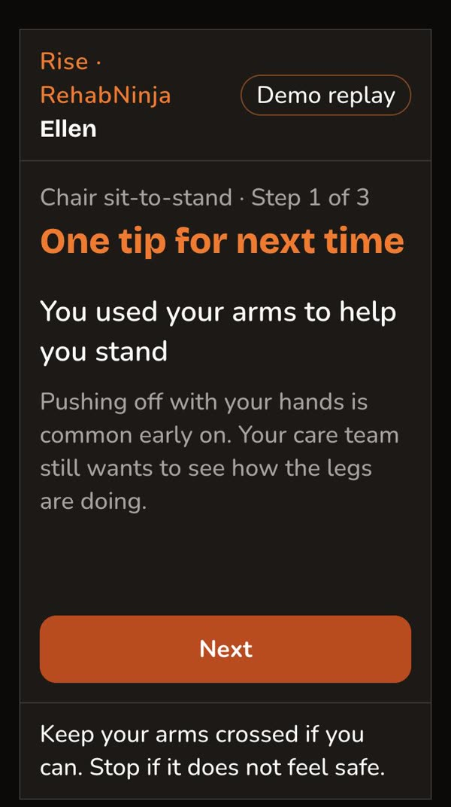
  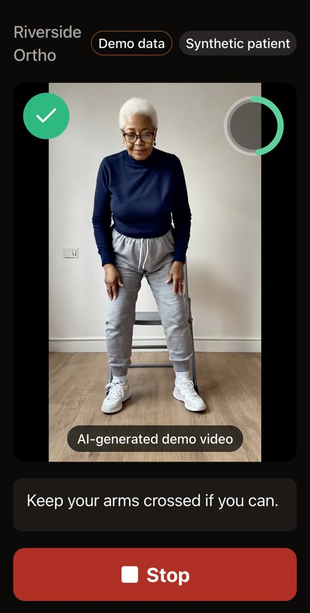
</p>

1. **Your week and your crew.** Patients see their own progress first. Below it is their crew, if they choose to join.
2. **Your home and today's missions.** Day since surgery, check-ins done, how last time felt, and the moves the program assigns for this stage: chair sit-to-stand, mini squat, or single-leg balance.
3. **Play.** The phone tracks the body on-device. Clean reps slice the fruit on the joints. Form breaks (knees caving in, moving too fast, pushing off with the hands, leaning to one side) become bombs. A single ElevenLabs coach voice reads every line, every line is captioned, and Stop is always on screen.
4. **Four quick questions.** Pain, dizziness, shortness of breath or chest pain, and calf pain or swelling. A yes to breath or chest pain goes straight to call-911 instructions.
5. **Closing, in three short steps.** One tip for next time, how today went compared with last time, and an optional note for the nurse. There is never a clinical score.

The **classic check-in** (`/p/<patient>`) is the same CDC test as a voice-led flow with no game. Until the camera is on, a picture guide shows each safety check: a chair without armrests against a wall, a helper nearby, and the phone on the floor.

## The crew: recovering together

Recovery at home can be lonely. The crew turns rehab into something people do together without turning it into a competition.

<p>
  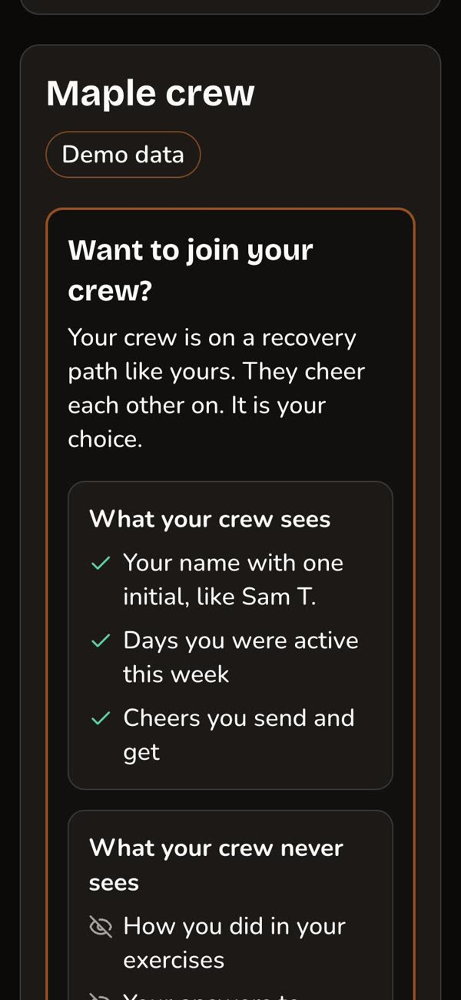
  
</p>

- **Opt-in, with plain consent.** Before joining, patients see exactly what their crew will see (first name and initial, days active this week, cheers) and what it never sees (exercise results, health answers, messages with the care team). Joining, leaving, and showing or hiding a photo are each recorded in a consent log. Patients can leave at any time.
- **Motivation, not rank.** There are no ranks, places, scores, or rep counts. The crew shares a weekly goal of 2 active days per member, loosely informed by CDC's guidance of at least 2 days a week of muscle-strengthening activity for older adults. It is a Rise default, not a clinical dose. Cheers come from a fixed, friendly set, sent from a verified device, so nothing negative can be written.
- **Safe by default.** When a session escalates, the patient is quietly put on hold from their crew. Peers no longer see them, and no one is told to "keep going" after being told to rest. Only a clinician returns them to their crew, with a recorded reason.
- **Neutral crew names** like "Maple crew" never reveal a procedure or diagnosis. The crew peers in the demo are synthetic.

## The clinic platform: launch protocols, manage escalation

The staff link on the start screen opens the clinic console (`/clinic`). It is where the care team starts each check-in and decides what happens after.

<p>
  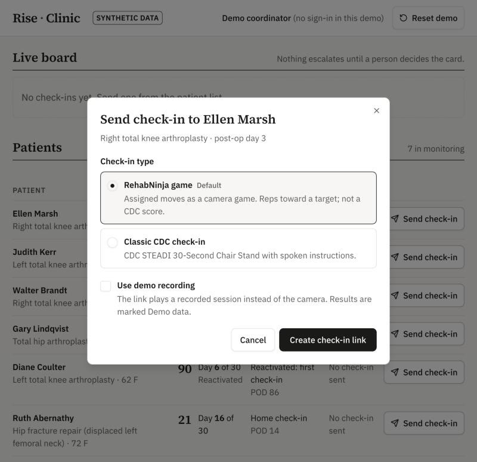
  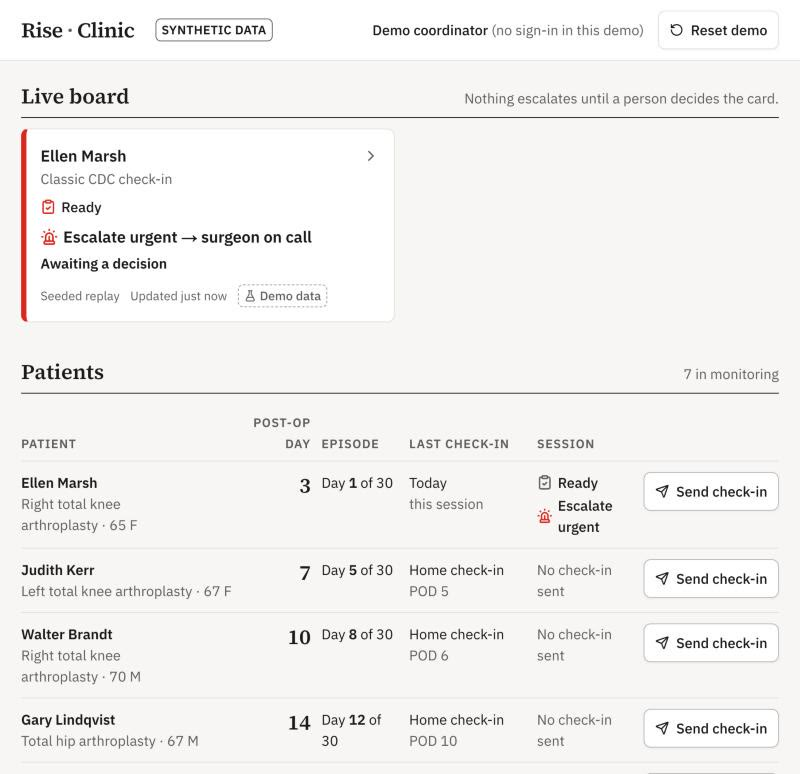
</p>
<p>
  
  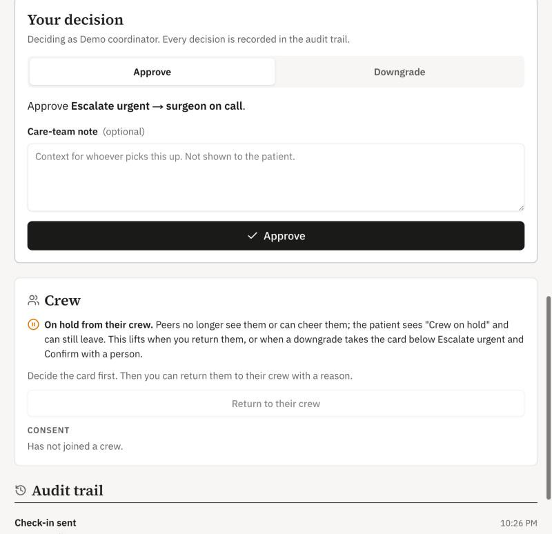
</p>

- **Launch a protocol for each patient.** From the patient list, a coordinator sends a check-in link and chooses the protocol: the RehabNinja game (the moves assigned for this recovery stage, not a CDC score) or the classic CDC STEADI 30-Second Chair Stand with spoken instructions. Protocol defaults, such as cadence by post-op day, decline thresholds, symptom questions, and crew rules, live in [`config/protocol.default.json`](config/protocol.default.json). They are labeled as Rise defaults, not clinical standards, and every override needs a reason code.
- **Watch it live.** Sessions stream onto the live board as they happen, from setting up through testing to ready.
- **Triage by written rules, never a model.** [`lib/rules.ts`](lib/rules.ts) produces the recommendation: escalate urgent, nurse callback, or continue the plan. It routes to the surgeon on call within 30 days of surgery, or to primary care or PT. The card shows which rule fired and why (for Ellen: 3 stands against 5 last time, arms used from rep 2), along with the CDC result, symptoms, and the patient's note quoted exactly as written.
- **A person decides every escalation.** Nothing is sent or escalated until someone clicks. They can approve the recommendation or downgrade it with a reason, such as spoke with the patient, finding already known, camera problem, or in-person visit within 24 hours. Every decision goes into the audit trail. A red-flag answer is the one exception: the patient sees the emergency line immediately.
- **Crew controls.** The card shows the patient's crew hold and consent history, and returns them to their crew once the card is decided.
- **Gated.** On the public tunnel, the console sits behind a `CONSOLE_KEY` cookie, and every POST must come from the same site.

## YOLO detects, Cosmos verifies

The game reacts instantly because YOLO runs on the phone. Every time YOLO flags a form break (knees caving, too fast, hands pushing off, leaning) or loses tracking, Rise also sends the last ~2 seconds of camera frames to **NVIDIA Cosmos** (`cosmos3-nano-reasoner`, the event's NIM) for a second look. The clinic strip shows whether Cosmos confirms what YOLO saw, what it observed, and "Needs a human look" if anything looks unsafe. With four 448 px frames, Cosmos answers in about 1.3–3.6 s.

<p>
  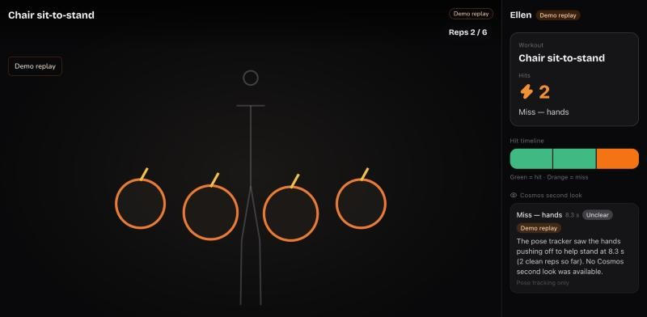
</p>

The screenshot is from Ellen's demo replay, which has no camera frames, so the entry is the pose-only fallback, badged "Demo replay". With the live camera, the entry is Cosmos's own reply. Here's a real one from the event endpoint, run on a still frame with no motion to judge:

```json
{
  "verdict": "unclear",
  "observation": "The frames show a stick figure in a chair sit-to-stand exercise with green and red circles indicating the knees and hips. The figure remains seated in all visible frames, with no clear movement toward standing or any visible hand position on the chest or thighs.",
  "compensations": [],
  "steadiness": "steady",
  "safetyConcern": false,
  "uncertainty": "No movement is visible across the frames; the figure remains seated, making it impossible to confirm or deny the flagged hand position.",
  "model": "nvidia/cosmos3-nano-reasoner",
  "latencyMs": 1612,
  "demoData": false
}
```

Cosmos is care-team only. It never changes hits, bombs, or triage, and never talks to the patient.

## What the patient sees vs. what the care team gets

| What the patient sees | What the care team gets |
| --- | --- |
| Fruit, bombs, reps toward a target | CDC STEADI 30-Second Chair Stand: raw stands, the arm-use rule (score 0 if arms are used), knee asymmetry, pauses |
| "Today seemed harder than last time" | The trend against the patient's own last check-in |
| One friendly tip | Which form break fired, and when |
| Their crew's cheers | Crew hold and consent history on the triage card |
| Nothing scary | Deterministic triage, routed to surgeon, primary care, or PT, approved by a person |

Patient-facing text comes only from locked copy files, written to SAMHSA's trauma-informed principles.

## Demo mode and the AI-generated demo video

**Try a demo** and the console's **Use demo recording** run without a camera. For Ellen, both play a 30-second AI-generated video of a synthetic older woman doing the chair stand: one clean stand with her arms crossed, then two where she pushes off her thighs. It is labeled "AI-generated demo video" wherever it appears.

- **Classic check-in:** the video plays in the camera frame, in step with keypoints recorded from it ([`public/fixtures/rise-01-arms.json`](public/fixtures/rise-01-arms.json)). The counter and triage run on exactly what the video shows.
- **RehabNinja:** the video plays picture-in-picture while the medic ninja moves from her keypoints, so clean stands earn fruit and push-offs earn bombs. Add `?replay=1` to force the replay on a laptop that has a camera.

The video was made with the Runway API ([`scripts/gen-demo-video.ts`](scripts/gen-demo-video.ts), dry run by default, with a credit cap). Every other patient uses a synthetic keypoint replay.

## Under the hood

```
Phone camera ──> pose on-device (YOLO11n-pose ONNX via WebGPU/WASM, MediaPipe fallback)
             ──> stand counter / form findings ──> fruit, bombs, reps (RehabNinja)
                                               ├─> on a form break: last ~2 s of frames ──> Cosmos second look ──> clinic strip
                                               └─> CDC score + deterministic triage rules ──> live clinic board (SSE) ──> human decision ──> audit trail
Crew: opt-in membership, consent log, device-token cheers, auto-hold on escalation
Voice: ElevenLabs lines pre-rendered to public/voice (hash-keyed; browser speech fallback)
Hosting: rise.nextrex.health ──> Cloudflare Worker (rise-edge) ──> one Cloudflare Container (next start)
```

- **Pose tiers:** YOLO is kept only at 15 fps or more on the phone (benchmarked at 16.6 fps with WebGPU on Rex's phone). MediaPipe is preloaded and takes over mid-set if YOLO drops under 12 fps for 2 s. A demo replay drives the same code with no camera.
- **Counter:** knee angle plus hip rise with hysteresis, the CDC half-way rule at 30 s, arm use, mid-rise asymmetry, and pauses. Arm use is judged against the patient's own seated arms-crossed pose, so a phone propped side-on or in front both work. Unit-tested against all seven seed patients and the recorded demo fixture.
- **Cosmos second look:** when YOLO flags a form break or loses tracking during live play, the last ~2 s of camera frames (4 downscaled JPEGs, never stored) and YOLO's numbers go to Cosmos through `POST /api/cosmos/second-look`. It uses an OpenAI-compatible endpoint (`COSMOS_BASE_URL`, `COSMOS_API_KEY`, `COSMOS_MODEL` in `.env.local`; check it with `npm run cosmos:probe`). When Cosmos is unavailable, a pose-only fallback is shown, badged "Demo data".
- **Hosting:** Cloudflare Worker `rise-edge` and one Cloudflare Container (`cloudflare/`, `Dockerfile`).
- **Clinic and crew state:** in-memory session and crew stores, a server-sent event stream to the console, Zod contracts in [`lib/types.ts`](lib/types.ts), and a console gate in [`proxy.ts`](proxy.ts).
- **Built, not yet wired:** a W&B agent note (Weave-traced), VAST clip ingest and semantic search, Twilio invites, and the FHIR handoff have typed contracts and stubs in `lib/ai/` and `lib/adapters/`, but make no live calls yet.

## Run it

```bash
npm install
cp .env.example .env.local   # optional; the demo runs without keys
npm run dev -- -p 3400        # http://localhost:3400
npm run check                 # typecheck + tests
npm run voice                 # re-render changed voice lines (needs ELEVENLABS_* in .env.local)
npm run cosmos:probe          # check the Cosmos endpoint: model, latency, one real second look
npm run tunnel:named          # https://rise.nextrex.health -> :3400 (named tunnel "rise")
bash scripts/install-tunnel-service.sh  # same tunnel as a login service (survives restarts)
```

**Deploy (rise.nextrex.health):** `cloudflare/` holds the `rise-edge` Worker, which forwards every request to a single `RiseContainer`. It runs one instance on purpose, because the session board, crew, and live stream live in that server's memory. The container image is the root `Dockerfile` (`next start` on :8080). It needs Docker running locally (`colima start`) and wrangler signed in. Deploy with:

```bash
cd cloudflare && npm install && npx wrangler deploy
```

After 2 hours without traffic the container sleeps; the next request wakes it in about 10 s with fresh demo data.

Phone camera access needs HTTPS, so test on a phone through the tunnel or the deployed site. The YOLO model (`public/models/pose.onnx`) is not committed; export it with `scripts/export_pose_onnx.py` (version pins for Intel Macs are in [docs/PREFLIGHT.md](docs/PREFLIGHT.md)). Without it, RehabNinja uses MediaPipe.

Pages: `/` (start), `/play` (your week and crew), `/play/<patient>` (home and play), `/p/<patient>` (classic check-in), and `/clinic` (console; set `CONSOLE_KEY` before exposing it). Dev pages: `/dev/pose` (fps benchmark per tier) and `/dev/fixtures` (record keypoint fixtures; `?clip=/demo/sit-to-stand.mp4` records from the demo video).

## The players

Seven synthetic patients from [seed/patients.json](seed/patients.json) (see [seed/README.md](seed/README.md)): Ellen Marsh (the demo patient: arms from rep 2, short of breath), Judith Kerr, Walter Brandt, Gary Lindqvist, Diane Coulter, Ruth Abernathy, and Harold Pruitt. Each scenario echoes the next real event in the source chart, so its expected triage doubles as the test oracle.

## Limitations

- Remote, phone-scored STEADI administration is not validated. Rise compares patients mainly with themselves and triggers a human call, not a diagnosis. Hits and misses are motivation, not a clinical measure.
- The crew is engagement only. Its weekly goal is a Rise default, not a prescribed dose, and it has not been studied for effects on isolation or outcomes.
- Synthetic data only. The console has a single demo coordinator, with no staff sign-in, EHR connection, or compliance infrastructure. Session and crew state lives in memory.

## More

[Build plan](docs/BUILD-PLAN.md) · [Day-of runbook](docs/DAY-OF.md) · [RehabNinja pitch script](docs/PLAY-DEMO.md) · [Preflight](docs/PREFLIGHT.md)

## Team and credits

- Rex Belgarde ([@rexbel](https://github.com/rexbel)): pose tracking, stand counter, triage rules, clinic console, crew, classic check-in, Cosmos second look, voice, demo video, hosting.
- Jeremiah Richard ([@thetradingdoc](https://github.com/thetradingdoc)): RehabNinja game, cohort board and player home, programs, form findings, session report.
- Patients: [Synthetic Hospital v1.3](https://github.com/sparkcpark/synthetic_hospital) (MIT), Park, Chen, Dettmers, 2026.
- Protocol: CDC STEADI [30-Second Chair Stand](https://www.cdc.gov/steadi/media/pdfs/STEADI-Assessment-30Sec-508.pdf) and [4-Stage Balance](https://www.cdc.gov/steadi/media/pdfs/STEADI-Assessment-4Stage-508.pdf). Crew weekly goal informed by CDC's [physical activity guidelines for older adults](https://www.cdc.gov/physical-activity-basics/guidelines/older-adults.html).
- Patient language: SAMHSA's six trauma-informed principles. Voice: ElevenLabs. Demo video: Runway (AI-generated, synthetic person). Pose: Ultralytics YOLO11, Google MediaPipe. UI: [shadcn/ui](https://ui.shadcn.com), PixiJS.
